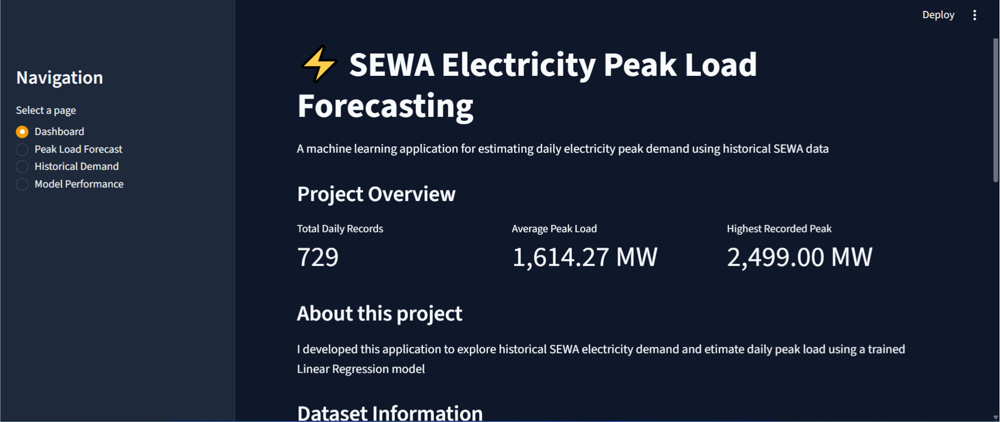

# SEWA Daily Peak Electricity Demand Forecasting System

## 1. Project Overview

In this project, I developed a machine learning model to estimate daily peak electricity demand using historical SEWA electricity data from 2020 and 2021.

I used Python and machine learning techniques to clean the data, study electricity demand patterns, build prediction models, and develop an interactive Streamlit application.

The main goal is to show how machine learning can help electricity providers understand demand patterns and improve their planning.

## Application Preview

## Dashboard



### Weather Input


*Figure 1: Dashboard of the SEWA Electricity Peak Load Forecasting Application.*
## 2. Problem Statement

Electricity demand changes from day to day. Weather conditions, time of the year, and previous electricity consumption can affect how much electricity people use.

When electricity providers do not have a good understanding of demand patterns, it can be difficult to plan their resources and prepare for periods of high demand.

In this project, I used historical SEWA electricity data to build machine learning models that estimate daily peak electricity demand.

## 3. Project Objectives

- Explore historical electricity demand data.
- Identify and correct data quality issues where reliable corrections were possible.
- Study daily and monthly electricity demand patterns.
- Examine the relationship between weather conditions and electricity demand.
- Create useful features for machine learning.
- Build and compare different prediction models.
- Evaluate model performance.
- Develop an interactive Streamlit application.

## 4. Dataset

I used SEWA electricity demand data covering 2020 and 2021.

The dataset contains daily electricity demand measurements and weather information.

Key variables include:

- Date
- Maximum temperature
- Minimum temperature
- Maximum humidity
- Minimum humidity
- Average temperature
- Average humidity
- Daily peak electricity load (MW)

After preparing and combining the daily records, I obtained a modelling dataset containing 729 observations.

## 5. Project Workflow

### 5.1 Data Understanding and Cleaning

I loaded and examined the original datasets. I checked for missing values, duplicate records, inconsistent measurements, invalid values, and possible outliers.

I corrected data issues where I had enough information to support the correction. I also retained uncertain values as missing rather than making assumptions.

### 5.2 Exploratory Data Analysis (EDA)

I studied electricity demand over time and examined monthly and weekly demand patterns.

I also investigated the relationship between weather conditions and peak electricity demand.

My analysis showed a strong positive relationship between temperature and peak electricity demand.

### 5.3 Feature Engineering

I created additional features to help the models learn from historical demand patterns.

These features include:

- Year
- Month
- Day of the week
- Weekend indicator
- Previous day's peak load
- Previous seven-day average peak load

### 5.4 Model Development

I developed and compared three approaches:

1. Baseline Model
2. Linear Regression
3. Random Forest Regressor

I used a chronological training and testing split to ensure that the model was evaluated on later records rather than randomly selected observations.

### 5.5 Model Evaluation

I evaluated the models using three performance metrics:

- MAE: Measures the average size of prediction errors.
- RMSE: Measures prediction errors while giving more weight to larger errors.
- R²: Measures how well the model explains changes in electricity demand.

### 5.6 Application Development

I built an interactive application using Streamlit.

The application allows users to:

- View an overview of the project.
- Enter weather information to estimate peak load.
- Explore historical electricity demand.
- Compare the performance of the evaluated models.

## 6. Model Performance

I evaluated all three models using the same test dataset.

| Model | MAE (MW) | RMSE (MW) | R² |
|---|---:|---:|---:|
| Baseline | 56.35 | 75.24 | 0.9761 |
| Linear Regression | 42.53 | 55.09 | 0.9872 |
| Random Forest | 49.99 | 62.78 | 0.9834 |

### Selected Model: Linear Regression

Linear Regression achieved the best results among the three models.

It recorded:

- MAE: 42.53 MW
- RMSE: 55.09 MW
- R²: 0.9872

Based on these results, I selected Linear Regression as the model used in the Streamlit application.

## 7. Business Impact

This project demonstrates how machine learning can support electricity planning and decision-making.

Some possible business benefits include:

- Demand Planning: Helps electricity providers estimate expected peak demand and plan ahead.
- Resource Allocation: Supports better planning of available electricity resources and distribution capacity.
- Operational Planning: Helps electricity providers prepare for periods when demand may increase.
- Weather Analysis: Shows how weather conditions, especially temperature, relate to electricity demand.
- Better Decision-Making:Turns historical electricity data into useful information that can support planning decisions.

### Practical Value

An electricity provider could use a system like this to better understand demand patterns, prepare for periods of high consumption, and improve its planning process.

These are potential benefits. The system has not yet been tested in a live electricity utility environment.

## 8. Tools and Technologies

I used the following tools and technologies:

- Python: Main programming language.
- Pandas: Data cleaning and analysis.
- NumPy: Numerical calculations.
- Matplotlib and Seaborn: Data visualisation.
- Scikit-learn: Machine learning and model evaluation.
- Jupyter Notebook: Data analysis and model development.
- Streamlit: Interactive web application.
- Git and GitHub: Version control and project management.

## 9. Project Structure

```text
SEWA-Peak-Load-Forecasting/
│
├── app/
│   └── app.py
│
├── data/
│   ├── raw/
│   └── processed/
│
├── figures/
│
├── models/
│
├── notebooks/
│
├── reports/
│
├── .gitignore
├── README.md
└── requirements.txt
```

## 10. How to Run the Application

Follow these steps to run the application on your computer.

### Step 1: Clone the repository

```bash
git clone https://github.com/NSJeremiah01/sewa-peak-load-forecasting.git
```

### Step 2: Open the project folder

```bash
cd sewa-peak-load-forecasting
```

### Step 3: Install the required libraries

```bash
pip install -r requirements.txt
```

### Step 4: Run the application

```bash
streamlit run app/app.py
```

Make sure the trained model and processed dataset are available in their expected folders.

## 11. Project Limitations

There are some limitations to this project:

- The dataset covers only 2020 and 2021.
- Some records had data quality issues that could not be fully resolved.
- The model uses same-day weather observations as input.
- The current application uses the latest available historical demand values for its demand-related features.
- The application has not been tested with live electricity demand data.

The model evaluation represents a retrospective, weather-assisted estimation exercise. It does not yet demonstrate a fully operational next-day forecasting system.

## 12. Project Status

I have completed:

- Data understanding and cleaning.
- Exploratory data analysis.
- Feature engineering.
- Model development and evaluation.
- Linear Regression model selection.
- Initial Streamlit application development.

The next stage is to deploy the application and improve its forecasting capabilities.

## 13. Disclaimer

This is an independent educational and portfolio project. It is not affiliated with or endorsed by SEWA.

The results are based on historical data and should not be treated as official electricity demand forecasts.